# Database schema and design rationale

## Scope and architecture

The checked-in database definition consists of **23 application tables and two views** in `public`, plus the Supabase-managed `auth.users` identity table. This reference describes `schema.sql` together with the content, trail, battle, stake, image, offline, zone and trading migrations. Existing hosted databases may differ until the corresponding migrations are applied.

The browser authenticates through Supabase Auth and sends its token to Express. Application data is read and changed through parameterized PostgreSQL queries using `pg`. The database connection pool has a maximum of 10 connections, a 10-second connection timeout and a 15-second statement timeout. Multi-step operations use a shared transaction client with commit or rollback.

Deployment configuration and migration order are documented in [Deployment](deployment.md). Endpoint contracts remain in the [API reference](../handwritten-api.md).

## Column reference

`PK` means primary key; `FK` means foreign key. Primary-key columns are implicitly non-null. Other columns are nullable unless marked `NOT NULL`. A default does not prevent an explicit null. Foreign keys use PostgreSQL's default `NO ACTION` deletion behaviour unless `ON DELETE CASCADE` is shown. Unspecified defaults are absent.

### `campaigns`

Scheduled time windows for grouping events around terms or campus open days.

Source: `backend/sql/schema.sql`.

| Column | Type | Constraints and default |
|---|---|---|
| `id` | `uuid` | `PRIMARY KEY DEFAULT gen_random_uuid()` |
| `name` | `text` | `NOT NULL` |
| `starts_at` | `timestamptz` | `NOT NULL` |
| `ends_at` | `timestamptz` | `NOT NULL` |
| `created_at` | `timestamptz` | `DEFAULT now()` |

Table constraints: `CHECK (ends_at > starts_at)`.

### `events`

Campus quests, their location boundaries, availability windows, campaign grouping and publication state.

Source: `backend/sql/schema.sql`, `backend/sql/content-publication.sql`, `backend/sql/procedural-events.sql`.

| Column | Type | Constraints and default |
|---|---|---|
| `id` | `uuid` | `PRIMARY KEY DEFAULT gen_random_uuid()` |
| `title` | `text` | `NOT NULL` |
| `description` | `text` | Nullable; no default. |
| `latitude` | `double precision` | `NOT NULL CHECK (latitude BETWEEN -90 AND 90)` |
| `longitude` | `double precision` | `NOT NULL CHECK (longitude BETWEEN -180 AND 180)` |
| `radius_meters` | `integer` | `NOT NULL CHECK (radius_meters > 0)` |
| `access_code` | `text` | Nullable; no default. |
| `starts_at` | `timestamptz` | `NOT NULL` |
| `ends_at` | `timestamptz` | `NOT NULL` |
| `campaign_id` | `uuid` | `REFERENCES public.campaigns(id)` |
| `retired_at` | `timestamptz` | Nullable; no default. |
| `is_procedural` | `boolean` | `NOT NULL DEFAULT false` |
| `is_auto_generated` | `boolean` | `NOT NULL DEFAULT false` |
| `auto_placement_metadata` | `jsonb` | `DEFAULT '{}'::jsonb` |
| `created_at` | `timestamptz` | `DEFAULT now()` |
| `draft_revision` | `integer` | `NOT NULL DEFAULT 1` |
| `published_revision` | `integer` | Nullable; no default. |
| `published_snapshot` | `jsonb` | Nullable; no default. |
| `reviewed_revision` | `integer` | Nullable; no default. |
| `reviewed_by` | `uuid` | Nullable; no default. |
| `published_at` | `timestamptz` | Nullable; no default. |

Table constraints: `CHECK (ends_at > starts_at)`.

`campaign_id` groups events under a term or open-day window. A retired event has a non-null `retired_at` and is filtered from player-facing queries.

`is_procedural` marks events placed by the automatic distribution system; `is_auto_generated` and `auto_placement_metadata` carry generation details (campus zone, placement reason, rotation group). These fields are administrative and not exposed to players.

`reviewed_by` records an administrator UUID without an Auth foreign key. Publication revisions and snapshots are coordinated by the API; their consistency is not enforced by SQL check constraints.

### `cards`

Card definitions shared by all owned copies.

Source: `backend/sql/schema.sql`.

| Column | Type | Constraints and default |
|---|---|---|
| `id` | `uuid` | `PRIMARY KEY DEFAULT gen_random_uuid()` |
| `event_id` | `uuid` | `REFERENCES public.events(id)` |
| `title` | `text` | `NOT NULL` |
| `rarity` | `text` | `NOT NULL CHECK (rarity IN ('Blue','Black','Gold'))` |
| `description` | `text` | Nullable; no default. |
| `accent` | `text` | Nullable; no default. |
| `badge` | `text` | Nullable; no default. |
| `strength` | `text` | Nullable; no default. |
| `points` | `integer` | `NOT NULL CHECK (points >= 0)` |
| `tag` | `text` | Nullable; no default. |
| `created_at` | `timestamptz` | `DEFAULT now()` |

`card-battles.sql` also adds `cards_battle_points_range`: `CHECK (points BETWEEN 0 AND 100) NOT VALID`. New inserts and updates must satisfy the range; older rows are not retrospectively validated by this migration.

Rarity is the design hook for collection rarity: Blue, Black and Gold correspond to progressively rarer drops. Drop-rate monitoring (see analytics section) uses `cards.rarity` and `cards.event_id`.

### `challenges`

Questions and their reward-card references.

Source: `backend/sql/schema.sql`, `backend/sql/content-publication.sql`.

| Column | Type | Constraints and default |
|---|---|---|
| `id` | `uuid` | `PRIMARY KEY DEFAULT gen_random_uuid()` |
| `event_id` | `uuid` | `NOT NULL REFERENCES public.events(id)` |
| `question_text` | `text` | `NOT NULL` |
| `question_type` | `text` | `NOT NULL CHECK (question_type IN ('text','true_false','multiple_choice'))` |
| `options` | `jsonb` | Nullable; no default. |
| `correct_answer` | `text` | `NOT NULL` |
| `card_id` | `uuid` | `REFERENCES public.cards(id)` |
| `created_at` | `timestamptz` | `DEFAULT now()` |
| `draft_revision` | `integer` | `NOT NULL DEFAULT 1` |
| `published_revision` | `integer` | Nullable; no default. |
| `published_snapshot` | `jsonb` | Nullable; no default. |
| `reviewed_revision` | `integer` | Nullable; no default. |
| `reviewed_by` | `uuid` | Nullable; no default. |
| `published_at` | `timestamptz` | Nullable; no default. |

`reviewed_by` records an administrator UUID without an Auth foreign key. Publication revisions and snapshots are coordinated by the API; their consistency is not enforced by SQL check constraints.

### `location_verifications`

Player presence observations and suspicious-location flags.

Source: `backend/sql/schema.sql`.

| Column | Type | Constraints and default |
|---|---|---|
| `id` | `uuid` | `PRIMARY KEY DEFAULT gen_random_uuid()` |
| `player_id` | `uuid` | `NOT NULL REFERENCES auth.users(id)` |
| `event_id` | `uuid` | `NOT NULL REFERENCES public.events(id)` |
| `distance_meters` | `double precision` | `NOT NULL` |
| `verified_at` | `timestamptz` | `NOT NULL DEFAULT now()` |
| `latitude` | `double precision` | Nullable; no default. |
| `longitude` | `double precision` | Nullable; no default. |
| `flagged` | `boolean` | `NOT NULL DEFAULT false` |
| `flag_reason` | `text` | Nullable; no default. |

`flagged` and `flag_reason` are set when the API detects an implausible journey or an unreliable GPS fix. They feed the trust-score system described below.

### `challenge_attempts`

One answer outcome per player and challenge.

Source: `backend/sql/schema.sql`, `backend/sql/migrate-existing.sql`.

| Column | Type | Constraints and default |
|---|---|---|
| `id` | `uuid` | `PRIMARY KEY DEFAULT gen_random_uuid()` |
| `player_id` | `uuid` | `NOT NULL REFERENCES auth.users(id)` |
| `event_id` | `uuid` | `NOT NULL REFERENCES public.events(id)` |
| `challenge_id` | `uuid` | `NOT NULL REFERENCES public.challenges(id)` |
| `correct` | `boolean` | `NOT NULL` |
| `answered_at` | `timestamptz` | `DEFAULT now()` |

Table constraints: `UNIQUE(player_id,challenge_id)`.

The legacy migration backfills `challenge_id` from `event_id` where the event has exactly one challenge. Attempts on multi-challenge events must be mapped manually before the migration can commit.

### `offline_attempt_sessions`

Server-issued leases for bounded, replay-safe offline challenge attempts.

Source: `backend/sql/offline-attempts.sql`.

| Column | Type | Constraints and default |
|---|---|---|
| `id` | `uuid` | `PRIMARY KEY DEFAULT gen_random_uuid()` |
| `player_id` | `uuid` | `NOT NULL REFERENCES auth.users(id) ON DELETE CASCADE` |
| `event_id` | `uuid` | `NOT NULL REFERENCES public.events(id) ON DELETE CASCADE` |
| `challenge_id` | `uuid` | `NOT NULL REFERENCES public.challenges(id) ON DELETE CASCADE` |
| `verification_id` | `uuid` | `NOT NULL REFERENCES public.location_verifications(id) ON DELETE CASCADE` |
| `challenge_revision` | `integer` | Nullable; no default. |
| `correct_answer_snapshot` | `text` | `NOT NULL` |
| `card_id_snapshot` | `uuid` | `REFERENCES public.cards(id)` |
| `issued_at` | `timestamptz` | `NOT NULL DEFAULT now()` |
| `expires_at` | `timestamptz` | `NOT NULL` |
| `sync_deadline` | `timestamptz` | `NOT NULL` |
| `consumed_at` | `timestamptz` | Nullable; no default. |
| `client_attempt_id` | `uuid` | `UNIQUE`, nullable |

Table constraints: `CHECK (expires_at > issued_at)`, `CHECK (sync_deadline >= expires_at)`.

Each session grants a player the right to answer one challenge offline. The server captures the correct answer at issue time so the replay is graded against the published revision at issue, not the current one. `client_attempt_id` provides idempotency across retries; `consumed_at` is set on successful sync.

### `player_cards`

Individual collectible copies owned by players, including duplicates.

Source: `backend/sql/schema.sql`.

| Column | Type | Constraints and default |
|---|---|---|
| `id` | `uuid` | `PRIMARY KEY DEFAULT gen_random_uuid()` |
| `player_id` | `uuid` | `NOT NULL REFERENCES auth.users(id)` |
| `event_id` | `uuid` | `NOT NULL REFERENCES public.events(id)` |
| `card_id` | `uuid` | `NOT NULL REFERENCES public.cards(id)` |
| `awarded_at` | `timestamptz` | `DEFAULT now()` |

Duplicate copies share a `card_id` but have distinct `id` values, enabling exact-copy stakes and trades.

### `card_games`

Match participants, lifecycle, rule version and result.

Source: `backend/sql/schema.sql`, `backend/sql/card-battles.sql`, `backend/sql/battle-stakes.sql`.

| Column | Type | Constraints and default |
|---|---|---|
| `id` | `uuid` | `PRIMARY KEY DEFAULT gen_random_uuid()` |
| `player_one_id` | `uuid` | `NOT NULL REFERENCES auth.users(id)` |
| `player_two_id` | `uuid` | `REFERENCES auth.users(id)` |
| `category` | `text` | `NOT NULL` |
| `status` | `text` | `NOT NULL CHECK (status IN ('waiting','active','finished','cancelled'))` |
| `winner_id` | `uuid` | `REFERENCES auth.users(id)` |
| `created_at` | `timestamptz` | `DEFAULT now()` |
| `started_at` | `timestamptz` | Nullable; no default. |
| `finished_at` | `timestamptz` | Nullable; no default. |
| `player_one_last_seen_at` | `timestamptz` | Nullable; no default. |
| `player_two_last_seen_at` | `timestamptz` | Nullable; no default. |
| `rules_version` | `integer` | `NOT NULL DEFAULT 1` |
| `is_cpu` | `boolean` | `NOT NULL DEFAULT false` |
| `winner_side` | `integer` | `CHECK (winner_side IN (1,2))` |
| `stakes_enabled` | `boolean` | `NOT NULL DEFAULT false` |

Table constraints: `CHECK(player_one_id <> player_two_id)`.

`player_one_last_seen_at` and `player_two_last_seen_at` support asynchronous forfeit: a match with no activity from a player past the threshold can be closed. `rules_version` preserves the rule set an in-progress match was started under. `is_cpu` marks computer opponents; `winner_side` records outcomes when `winner_id` is null (CPU).

### `game_rounds`

Per-round choices, scores, turn deadlines and resolution.

Source: `backend/sql/schema.sql`, `backend/sql/card-battles.sql`, `backend/sql/timed-turns.sql`.

| Column | Type | Constraints and default |
|---|---|---|
| `id` | `uuid` | `PRIMARY KEY DEFAULT gen_random_uuid()` |
| `game_id` | `uuid` | `NOT NULL REFERENCES public.card_games(id)` |
| `round_number` | `integer` | `NOT NULL CHECK (round_number > 0)` |
| `player_one_card_id` | `uuid` | `REFERENCES public.cards(id)` |
| `player_two_card_id` | `uuid` | `REFERENCES public.cards(id)` |
| `player_one_points` | `integer` | Nullable; no default. |
| `player_two_points` | `integer` | Nullable; no default. |
| `winner_id` | `uuid` | `REFERENCES auth.users(id)` |
| `status` | `text` | `NOT NULL CHECK (status IN ('waiting','ready','finished'))` |
| `created_at` | `timestamptz` | `DEFAULT now()` |
| `finished_at` | `timestamptz` | Nullable; no default. |
| `winner_side` | `integer` | `CHECK (winner_side IN (1,2))` |
| `turn_deadline` | `timestamptz` | Nullable; no default. |
| `player_one_timed_out` | `boolean` | `NOT NULL DEFAULT false` |
| `player_two_timed_out` | `boolean` | `NOT NULL DEFAULT false` |

Table constraints: `UNIQUE(game_id,round_number)`.

`turn_deadline` enforces the 30-second server-side turn timer for live PvP. A player who does not act before the deadline is flagged through the corresponding `timed_out` column on the next server tick.

### `notifications`

Player notifications and read state.

Source: `backend/sql/schema.sql`, `backend/sql/migrate-existing.sql`.

| Column | Type | Constraints and default |
|---|---|---|
| `id` | `uuid` | `PRIMARY KEY DEFAULT gen_random_uuid()` |
| `user_id` | `uuid` | `NOT NULL REFERENCES auth.users(id)` |
| `title` | `text` | `NOT NULL` |
| `message` | `text` | `NOT NULL` |
| `href` | `text` | Nullable; no default. |
| `read_at` | `timestamptz` | Nullable; no default. |
| `created_at` | `timestamptz` | `NOT NULL DEFAULT now()` |

### `content_migrations`

One-time content migration markers.

Source: `backend/sql/content-publication.sql`.

| Column | Type | Constraints and default |
|---|---|---|
| `name` | `text` | `PRIMARY KEY` |

### `trails`

Ordered quest routes and their publication state.

Source: `backend/sql/trails.sql`.

| Column | Type | Constraints and default |
|---|---|---|
| `id` | `uuid` | `PRIMARY KEY DEFAULT gen_random_uuid()` |
| `title` | `text` | `NOT NULL` |
| `description` | `text` | Nullable; no default. |
| `event_ids` | `uuid[]` | `NOT NULL CHECK (cardinality(event_ids) BETWEEN 2 AND 20)` |
| `draft_revision` | `integer` | `NOT NULL DEFAULT 1` |
| `reviewed_revision` | `integer` | Nullable; no default. |
| `reviewed_by` | `uuid` | Nullable; no default. |
| `published_revision` | `integer` | Nullable; no default. |
| `published_snapshot` | `jsonb` | Nullable; no default. |
| `published_at` | `timestamptz` | Nullable; no default. |
| `created_at` | `timestamptz` | `NOT NULL DEFAULT now()` |

`reviewed_by` records an administrator UUID without an Auth foreign key. Publication revisions and snapshots are coordinated by the API; their consistency is not enforced by SQL check constraints.

`event_ids` preserves stop order. Array elements have no foreign keys; distinctness and event existence are validated by the API. Missing events can remain visible as unavailable stops rather than silently altering a published route.

### `battle_decks`

Committed card selections and frozen battle attributes for each side.

Source: `backend/sql/card-battles.sql`.

| Column | Type | Constraints and default |
|---|---|---|
| `game_id` | `uuid` | `NOT NULL REFERENCES public.card_games(id) ON DELETE CASCADE` |
| `side` | `integer` | `NOT NULL CHECK (side IN (1,2))` |
| `card_id` | `uuid` | `NOT NULL REFERENCES public.cards(id)` |
| `position` | `integer` | `NOT NULL CHECK (position BETWEEN 1 AND 5)` |
| `snapshot` | `jsonb` | `NOT NULL` |

Table constraints: `PRIMARY KEY (game_id,side,card_id)`; `UNIQUE(game_id,side,position)`.

### `battle_stakes`

The exact copy offered by each side, consent and settlement state.

Source: `backend/sql/battle-stakes.sql`.

| Column | Type | Constraints and default |
|---|---|---|
| `game_id` | `uuid` | `NOT NULL REFERENCES public.card_games(id) ON DELETE CASCADE` |
| `side` | `integer` | `NOT NULL CHECK (side IN (1,2))` |
| `copy_id` | `uuid` | `NOT NULL` |
| `snapshot` | `jsonb` | `NOT NULL` |
| `accepted` | `boolean` | `NOT NULL DEFAULT false` |
| `settled` | `boolean` | `NOT NULL DEFAULT false` |

Table constraints: `PRIMARY KEY(game_id,side)`.

`copy_id` identifies a `player_cards.id` logically but deliberately has no foreign key. The settled stake record can retain the original identity after later collection changes. The API checks ownership and reservation before play and transfers the copy transactionally.

### `player_profiles`

Optional profile images associated with Auth users.

Source: `backend/sql/profile-images.sql`.

| Column | Type | Constraints and default |
|---|---|---|
| `user_id` | `uuid` | `PRIMARY KEY REFERENCES auth.users(id) ON DELETE CASCADE` |
| `avatar` | `text` | `NOT NULL CHECK (length(avatar) <= 180000)` |

### `album_covers`

Optional collection cover images associated with events.

Source: `backend/sql/profile-images.sql`.

| Column | Type | Constraints and default |
|---|---|---|
| `event_id` | `uuid` | `PRIMARY KEY REFERENCES public.events(id) ON DELETE CASCADE` |
| `image` | `text` | `NOT NULL CHECK (length(image) <= 180000)` |

### `zones`

Author-created campus zones composed of existing events.

Source: `backend/sql/zones.sql`.

| Column | Type | Constraints and default |
|---|---|---|
| `id` | `uuid` | `PRIMARY KEY DEFAULT gen_random_uuid()` |
| `name` | `text` | `NOT NULL` |
| `description` | `text` | Nullable; no default. |
| `created_at` | `timestamptz` | `NOT NULL DEFAULT now()` |

### `zone_locations`

Join table mapping events to the zones they belong to.

Source: `backend/sql/zones.sql`.

| Column | Type | Constraints and default |
|---|---|---|
| `zone_id` | `uuid` | `NOT NULL REFERENCES public.zones(id) ON DELETE CASCADE` |
| `event_id` | `uuid` | `NOT NULL REFERENCES public.events(id) ON DELETE CASCADE` |

Table constraints: `PRIMARY KEY (zone_id, event_id)`.

### `zone_claims`

The current player controlling each zone.

Source: `backend/sql/zone-claims.sql`.

| Column | Type | Constraints and default |
|---|---|---|
| `id` | `uuid` | `PRIMARY KEY DEFAULT gen_random_uuid()` |
| `zone_id` | `uuid` | `NOT NULL REFERENCES public.zones(id) ON DELETE CASCADE` |
| `player_id` | `uuid` | `NOT NULL REFERENCES auth.users(id)` |
| `claimed_at` | `timestamptz` | `NOT NULL DEFAULT now()` |

Table constraints: `UNIQUE(zone_id)` — a zone has at most one controlling player.

Conflict resolution when multiple players contest a zone is handled by the API inside a transaction; the unique constraint guarantees only one claim is committed.

### `card_trades`

Player-to-player card trade offers and their resolution state.

Source: `backend/sql/card-trades.sql`.

| Column | Type | Constraints and default |
|---|---|---|
| `id` | `uuid` | `PRIMARY KEY DEFAULT gen_random_uuid()` |
| `sender_id` | `uuid` | `NOT NULL REFERENCES auth.users(id) ON DELETE CASCADE` |
| `recipient_id` | `uuid` | `NOT NULL REFERENCES auth.users(id) ON DELETE CASCADE` |
| `offered_card_id` | `uuid` | `NOT NULL REFERENCES public.cards(id) ON DELETE CASCADE` |
| `requested_card_id` | `uuid` | `NOT NULL REFERENCES public.cards(id) ON DELETE CASCADE` |
| `status` | `text` | `NOT NULL CHECK (status IN ('pending','accepted','declined','cancelled')) DEFAULT 'pending'` |
| `created_at` | `timestamptz` | `NOT NULL DEFAULT now()` |
| `updated_at` | `timestamptz` | `NOT NULL DEFAULT now()` |

Trade records hold card *definitions*, not specific copies. Ownership of a specific copy is checked by the API when the trade is accepted. Anti-abuse limits (rate, collection funneling) are enforced by the API, not the schema.

### `player_trust_score`

Current trust state for each player, adjusted by anti-cheat rules.

Source: `backend/sql/schema.sql`.

| Column | Type | Constraints and default |
|---|---|---|
| `player_id` | `uuid` | `PRIMARY KEY REFERENCES auth.users(id) ON DELETE CASCADE` |
| `score` | `integer` | `NOT NULL DEFAULT 100 CHECK (score BETWEEN 0 AND 100)` |
| `status` | `text` | `NOT NULL DEFAULT 'normal' CHECK (status IN ('normal','watched','restricted','banned'))` |
| `last_updated_at` | `timestamptz` | `DEFAULT now()` |

The `status` field drives automatic enforcement: `watched` increases verification strictness, `restricted` limits or blocks location verification, `banned` prevents gameplay. Transitions are managed by the trust service, which reads from `trust_events` for evidence.

### `trust_events`

Audit log of events that affected a player's trust score.

Source: `backend/sql/schema.sql`.

| Column | Type | Constraints and default |
|---|---|---|
| `id` | `uuid` | `PRIMARY KEY DEFAULT gen_random_uuid()` |
| `player_id` | `uuid` | `NOT NULL REFERENCES auth.users(id) ON DELETE CASCADE` |
| `event_type` | `text` | `NOT NULL` |
| `severity` | `integer` | `NOT NULL DEFAULT 1 CHECK (severity BETWEEN 1 AND 5)` |
| `metadata` | `jsonb` | `DEFAULT '{}'::jsonb` |
| `created_at` | `timestamptz` | `DEFAULT now()` |

### `moderation_flags`

Moderator console queue of suspicious players.

Source: `backend/sql/schema.sql`.

| Column | Type | Constraints and default |
|---|---|---|
| `id` | `uuid` | `PRIMARY KEY DEFAULT gen_random_uuid()` |
| `player_id` | `uuid` | `NOT NULL REFERENCES auth.users(id) ON DELETE CASCADE` |
| `reviewer_id` | `uuid` | `REFERENCES auth.users(id)` |
| `reason` | `text` | `NOT NULL` |
| `status` | `text` | `NOT NULL DEFAULT 'open' CHECK (status IN ('open','reviewed','resolved'))` |
| `action_taken` | `text` | `NOT NULL DEFAULT 'none' CHECK (action_taken IN ('none','warning','throttle','restricted','banned'))` |
| `created_at` | `timestamptz` | `DEFAULT now()` |
| `resolved_at` | `timestamptz` | Nullable; no default. |

### `player_ratings`

Matchmaking rating per player.

Source: `backend/sql/schema.sql`.

| Column | Type | Constraints and default |
|---|---|---|
| `player_id` | `uuid` | `PRIMARY KEY REFERENCES auth.users(id) ON DELETE CASCADE` |
| `rating` | `integer` | `NOT NULL DEFAULT 1200 CHECK (rating >= 0)` |
| `games_played` | `integer` | `NOT NULL DEFAULT 0 CHECK (games_played >= 0)` |
| `wins` | `integer` | `NOT NULL DEFAULT 0 CHECK (wins >= 0)` |
| `losses` | `integer` | `NOT NULL DEFAULT 0 CHECK (losses >= 0)` |
| `updated_at` | `timestamptz` | `DEFAULT now()` |

Season resets are performed by the API; the schema stores only current ratings. The initial value (1200) is a common Elo-style baseline.

## Published-content views

| View | Definition and purpose |
|---|---|
| `live_events` | Expands each non-null event `published_snapshot` using `jsonb_populate_record(NULL::public.events, ...)`. Player-facing queries read the published version. |
| `live_challenges` | Expands each non-null challenge `published_snapshot` using the challenge row type. Grading and question retrieval use published content. |

A null snapshot means the draft has no live row. Draft edits do not alter the live snapshot until publication. Trails store a published snapshot but have no separate `live_trails` view; trail queries interpret the snapshot directly.

The `draft-publication-v1` marker in `content_migrations` makes the initial publication backfill run once. Rerunning the migration does not publish drafts created after that backfill.

## Relationships

| Parent | Child/reference | Relationship |
|---|---|---|
| `auth.users` | `location_verifications.player_id`, `challenge_attempts.player_id`, `player_cards.player_id`, `notifications.user_id` | One user to many activity or collection records. |
| `auth.users` | `card_games.player_one_id`, `player_two_id`, `winner_id`; `game_rounds.winner_id` | Participants and optional recorded winners. |
| `auth.users` | `player_profiles.user_id`, `player_trust_score.player_id`, `player_ratings.player_id` | One user to zero or one profile, trust row and rating; cascade on deletion. |
| `auth.users` | `offline_attempt_sessions.player_id`, `trust_events.player_id`, `moderation_flags.player_id` | One user to many offline sessions, trust events and moderation flags; cascade on deletion. |
| `auth.users` | `zone_claims.player_id`, `card_trades.sender_id`, `card_trades.recipient_id` | Zone ownership and trade participants; cascade on deletion. |
| `campaigns` | `events.campaign_id` | One campaign to many scheduled events. |
| `events` | `cards.event_id`, `challenges.event_id`, `location_verifications.event_id`, `challenge_attempts.event_id`, `player_cards.event_id` | One quest to its cards, questions and activity. |
| `events` | `album_covers.event_id`, `offline_attempt_sessions.event_id`, `zone_locations.event_id` | One quest to zero or one cover, many offline sessions and zone memberships; cascade on deletion. |
| `cards` | `challenges.card_id`, `player_cards.card_id`, `battle_decks.card_id`, both `game_rounds` card columns, `offline_attempt_sessions.card_id_snapshot` | A shared definition referenced by rewards, copies and matches. |
| `cards` | `card_trades.offered_card_id`, `card_trades.requested_card_id` | Card definitions referenced by a trade; cascade on deletion. |
| `challenges` | `challenge_attempts.challenge_id`, `offline_attempt_sessions.challenge_id` | One question to many player outcomes and offline sessions; cascade on deletion for offline sessions. |
| `location_verifications` | `offline_attempt_sessions.verification_id` | One verification to many offline sessions; cascade on deletion. |
| `card_games` | `game_rounds.game_id` | One match to its rounds; no automatic cascade in the baseline. |
| `card_games` | `battle_decks.game_id`, `battle_stakes.game_id` | One match to committed decks and stakes; cascade on deletion. |
| `zones` | `zone_locations.zone_id`, `zone_claims.zone_id` | One zone to many locations and at most one claim; cascade on deletion. |
| `events` | `trails.event_ids` | Logical ordered membership; no element-level foreign key. |
| `player_cards` | `battle_stakes.copy_id` | Logical reference to a specific copy; no foreign key. |

Multiple foreign keys on a row do not by themselves prove that the referenced event, card and challenge belong together. Those cross-record rules are checked by application services.

### Entity relationship diagram

Solid relationships below represent foreign keys. The dotted relationship represents a logical reference without foreign-key enforcement.

```mermaid
erDiagram

    CAMPAIGNS {
        uuid id PK
        text name
        timestamptz starts_at
        timestamptz ends_at
        timestamptz created_at
    }

    EVENTS {
        uuid id PK
        text title
        text description
        float8 latitude
        float8 longitude
        int4 radius_meters
        text access_code
        timestamptz starts_at
        timestamptz ends_at
        uuid campaign_id FK
        timestamptz retired_at
        bool is_procedural
        bool is_auto_generated
        jsonb auto_placement_metadata
        timestamptz created_at
        int4 draft_revision
        int4 published_revision
        jsonb published_snapshot
        int4 reviewed_revision
        uuid reviewed_by
        timestamptz published_at
    }

    CARDS {
        uuid id PK
        uuid event_id FK
        text title
        text rarity
        text description
        text accent
        text badge
        text strength
        int4 points
        text tag
        timestamptz created_at
    }

    CHALLENGES {
        uuid id PK
        uuid event_id FK
        text question_text
        text question_type
        jsonb options
        text correct_answer
        uuid card_id FK
        timestamptz created_at
        int4 draft_revision
        int4 published_revision
        jsonb published_snapshot
        int4 reviewed_revision
        uuid reviewed_by
        timestamptz published_at
    }

    LOCATION_VERIFICATIONS {
        uuid id PK
        uuid player_id FK
        uuid event_id FK
        float8 distance_meters
        timestamptz verified_at
        float8 latitude
        float8 longitude
        bool flagged
        text flag_reason
    }

    CHALLENGE_ATTEMPTS {
        uuid id PK
        uuid player_id FK
        uuid event_id FK
        uuid challenge_id FK
        bool correct
        timestamptz answered_at
    }

    OFFLINE_ATTEMPT_SESSIONS {
        uuid id PK
        uuid player_id FK
        uuid event_id FK
        uuid challenge_id FK
        uuid verification_id FK
        int4 challenge_revision
        text correct_answer_snapshot
        uuid card_id_snapshot FK
        timestamptz issued_at
        timestamptz expires_at
        timestamptz sync_deadline
        timestamptz consumed_at
        uuid client_attempt_id
    }

    PLAYER_CARDS {
        uuid id PK
        uuid player_id FK
        uuid event_id FK
        uuid card_id FK
        timestamptz awarded_at
    }

    CARD_GAMES {
        uuid id PK
        uuid player_one_id FK
        uuid player_two_id FK
        text category
        text status
        uuid winner_id FK
        timestamptz created_at
        timestamptz started_at
        timestamptz finished_at
        timestamptz player_one_last_seen_at
        timestamptz player_two_last_seen_at
        int4 rules_version
        bool is_cpu
        int4 winner_side
        bool stakes_enabled
    }

    GAME_ROUNDS {
        uuid id PK
        uuid game_id FK
        int4 round_number
        uuid player_one_card_id FK
        uuid player_two_card_id FK
        int4 player_one_points
        int4 player_two_points
        uuid winner_id FK
        text status
        timestamptz created_at
        timestamptz finished_at
        int4 winner_side
        timestamptz turn_deadline
        bool player_one_timed_out
        bool player_two_timed_out
    }

    BATTLE_DECKS {
        uuid game_id PK
        int4 side PK
        uuid card_id PK
        int4 position
        jsonb snapshot
    }

    BATTLE_STAKES {
        uuid game_id PK
        int4 side PK
        uuid copy_id
        jsonb snapshot
        bool accepted
        bool settled
    }

    TRAILS {
        uuid id PK
        text title
        text description
        uuid_array event_ids
        int4 draft_revision
        int4 reviewed_revision
        uuid reviewed_by
        int4 published_revision
        jsonb published_snapshot
        timestamptz published_at
        timestamptz created_at
    }

    ZONES {
        uuid id PK
        text name
        text description
        timestamptz created_at
    }

    ZONE_LOCATIONS {
        uuid zone_id PK
        uuid event_id PK
    }

    ZONE_CLAIMS {
        uuid id PK
        uuid zone_id FK
        uuid player_id FK
        timestamptz claimed_at
    }

    CARD_TRADES {
        uuid id PK
        uuid sender_id FK
        uuid recipient_id FK
        uuid offered_card_id FK
        uuid requested_card_id FK
        text status
        timestamptz created_at
        timestamptz updated_at
    }

    PLAYER_TRUST_SCORE {
        uuid player_id PK
        int4 score
        text status
        timestamptz last_updated_at
    }

    TRUST_EVENTS {
        uuid id PK
        uuid player_id FK
        text event_type
        int4 severity
        jsonb metadata
        timestamptz created_at
    }

    MODERATION_FLAGS {
        uuid id PK
        uuid player_id FK
        uuid reviewer_id FK
        text reason
        text status
        text action_taken
        timestamptz created_at
        timestamptz resolved_at
    }

    PLAYER_RATINGS {
        uuid player_id PK
        int4 rating
        int4 games_played
        int4 wins
        int4 losses
        timestamptz updated_at
    }

    PLAYER_PROFILES {
        uuid user_id PK
        text avatar
    }

    ALBUM_COVERS {
        uuid event_id PK
        text image
    }

    NOTIFICATIONS {
        uuid id PK
        uuid user_id FK
        text title
        text message
        text href
        timestamptz read_at
        timestamptz created_at
    }

    CONTENT_MIGRATIONS {
        text name PK
    }

    AUTH_USERS {
        uuid id PK
    }

    CAMPAIGNS ||--o{ EVENTS : schedules
    EVENTS ||--o{ LOCATION_VERIFICATIONS : has
    EVENTS ||--o{ CHALLENGES : contains
    EVENTS ||--o{ PLAYER_CARDS : awards
    EVENTS ||--o{ CHALLENGE_ATTEMPTS : receives
    EVENTS ||--o{ CARDS : has
    EVENTS ||--o| ALBUM_COVERS : cover
    EVENTS ||--o{ OFFLINE_ATTEMPT_SESSIONS : session
    EVENTS ||--o{ ZONE_LOCATIONS : member

    CHALLENGES ||--o{ CHALLENGE_ATTEMPTS : attempts
    CHALLENGES ||--o{ OFFLINE_ATTEMPT_SESSIONS : lease
    CARDS ||--o{ CHALLENGES : reward

    LOCATION_VERIFICATIONS ||--o{ OFFLINE_ATTEMPT_SESSIONS : grounds

    AUTH_USERS ||--o{ LOCATION_VERIFICATIONS : submits
    AUTH_USERS ||--o{ PLAYER_CARDS : owns
    AUTH_USERS ||--o{ CHALLENGE_ATTEMPTS : makes
    AUTH_USERS ||--o| PLAYER_PROFILES : profile
    AUTH_USERS ||--o{ NOTIFICATIONS : receives
    AUTH_USERS ||--o{ OFFLINE_ATTEMPT_SESSIONS : leases
    AUTH_USERS ||--o{ ZONE_CLAIMS : claims
    AUTH_USERS ||--o{ CARD_TRADES : sends
    AUTH_USERS ||--o{ CARD_TRADES : receives
    AUTH_USERS ||--o| PLAYER_TRUST_SCORE : trust
    AUTH_USERS ||--o{ TRUST_EVENTS : generates
    AUTH_USERS ||--o{ MODERATION_FLAGS : flagged
    AUTH_USERS ||--o{ MODERATION_FLAGS : reviews
    AUTH_USERS ||--o| PLAYER_RATINGS : rated

    CARDS ||--o{ PLAYER_CARDS : copies
    CARDS ||--o{ CARD_TRADES : offered
    CARDS ||--o{ CARD_TRADES : requested
    CARDS ||--o{ OFFLINE_ATTEMPT_SESSIONS : rewards

    AUTH_USERS ||--o{ CARD_GAMES : player_one
    AUTH_USERS ||--o{ CARD_GAMES : player_two
    AUTH_USERS ||--o{ CARD_GAMES : winner

    CARD_GAMES ||--o{ GAME_ROUNDS : contains
    CARD_GAMES ||--o{ BATTLE_DECKS : decks
    CARD_GAMES ||--o{ BATTLE_STAKES : stakes

    CARDS ||--o{ GAME_ROUNDS : round_card
    CARDS ||--o{ BATTLE_DECKS : deck_card

    ZONES ||--o{ ZONE_LOCATIONS : contains
    ZONES ||--o{ ZONE_CLAIMS : controlled_by

    TRAILS }o--o{ EVENTS : event_ids
```

`content_migrations` is independent and has no relationships. The diagram groups player roles, trust roles and card-choice roles; the column tables specify each individual foreign key.

## Indexes and uniqueness

Primary keys and unique constraints create indexes for identity lookups and duplicate prevention. The baseline and feature migrations additionally define:

| Index | Columns | Purpose |
|---|---|---|
| `location_verifications_player_event_time` | `player_id, event_id, verified_at DESC` | Recent presence history for a player at an event. |
| `notifications_user_time` | `user_id, created_at DESC` | A player's newest notifications. |
| `offline_attempt_sessions_player_challenge` | `player_id, challenge_id, issued_at DESC` | Recent offline leases for a player and question. |
| `zone_claims_player_idx` | `player_id` | Zones currently held by a player. |
| `idx_card_trades_recipient` | `recipient_id, status` | Pending trades for a recipient. |
| `idx_card_trades_sender` | `sender_id, status` | Pending trades for a sender. |
| `trust_events_player_time` | `player_id, created_at DESC` | Recent trust events for a player. |
| `moderation_flags_status` | `status, created_at DESC` | Open moderation queue. |
| `player_ratings_rating` | `rating DESC` | Leaderboard and matchmaking lookups. |

`UNIQUE(player_id, challenge_id)` prevents a second persisted answer for the same player/question. `UNIQUE(game_id, round_number)` identifies one round per match number. Deck keys prevent repeated card identities and positions on the same side; the stake key allows at most one offer per side. `UNIQUE(zone_id)` on `zone_claims` allows one controlling player per zone. `UNIQUE(client_attempt_id)` on `offline_attempt_sessions` provides replay idempotency.

The legacy migration creates named unique indexes `challenge_attempts_player_question` and `game_rounds_game_number` for equivalent rules. The battle migration removes old player/card unique constraints so duplicate copies are permitted; it does not remove arbitrary standalone unique indexes from custom deployments.

## Access control and data lifecycle

The backend validates Auth tokens, determines the requesting player and applies ownership checks. Administrator access is based on UUIDs in `ADMIN_USER_IDS`, not usernames or email addresses. Moderator access uses the same mechanism.

`disable-data-api-access.sql` enables RLS and revokes browser-role grants for baseline application tables and known legacy RPCs. Feature migrations revoke access to their new tables/views; feature tables also enable RLS. The backend connection requires the intended privileged database role. RLS alone is not the backend authorisation mechanism when that role bypasses policies. Supabase Auth remains enabled while application data access goes through Express.

Account deletion locks the user and participating matches, rejects unresolved Card Duels and removes related activity and match data inside a transaction. Rows that cascade from `auth.users` deletion include profile, trust, rating, offline sessions, trust events, moderation flags, zone claims and trade records where the deleting player is sender or recipient. Deck and stake rows cascade from the game. Unexpected foreign-key dependencies cause rollback. Most baseline references intentionally do not cascade, so content removal also depends on explicit API handling.

## Design motivation and trade-offs

| Decision | Motivation | Trade-off |
|---|---|---|
| PostgreSQL with Supabase Auth | Relational constraints and transactions fit quests, ownership and matches; Auth supplies stable user identities. | Hosted Auth configuration remains an external dependency. |
| UUID identifiers | Links between Auth, API resources and database records use the same identifier type. | UUID validity does not establish authorisation. |
| Separate `cards` and `player_cards` | Card definitions are shared while each awarded copy has its own identity, enabling duplicates, exact-copy stakes and trades. | Ownership operations need transactional checks across records. |
| Per-challenge attempts | A player can answer multiple questions in one event while each question has one stored outcome. | Legacy per-event attempts need reliable question mapping. |
| `timestamptz` schedules | Event availability represents absolute instants while the UI can display local time. | Display timezone remains a frontend concern. |
| Draft revisions and JSON snapshots | Admin edits remain separate from published content; review can refer to a specific revision. | Snapshot fields are less constrained than normal relational columns. |
| Battle snapshots and rule versions | In-progress decks retain their captured attributes; older matches retain their rule version. | Snapshot storage duplicates card information. |
| Side identifiers for CPU matches | Both human and computer outcomes can be represented without an Auth user for the computer. | `winner_id` can be null while `winner_side` identifies the CPU winner. |
| Separate stake consent and settlement | Offered copies, mutual acceptance and a settlement guard have explicit persisted state. | Reservation and exact-copy transfer require service-level locking and validation. |
| Ordered trail UUID arrays | Route ordering is retained, including missing published stops. | SQL does not enforce element foreign keys or uniqueness. |
| Small images stored as text | Profile and album images use the same authenticated API without an additional storage service. | Encoded image strings increase row/response size; the schema limits each string to 180,000 characters. |
| Offline attempt leases | Bounded, server-issued leases prevent replay abuse and preserve the answer at the time of issue. | Server must issue and expire leases; clients must retry idempotently. |
| Trust score as a single row per player | Enforcement decisions read one row instead of aggregating history. | Score derivation lives in the API; the schema stores only current state. |
| Moderation flags decoupled from trust | Moderator review can override automatic enforcement without rewriting trust history. | Two tables must be kept consistent by the API. |
| Matchmaking rating separate from trust | Competitive skill and anti-cheat concerns use different state and different lifecycles. | Two player-scoped rows are written on separate paths. |
| Zones as ordered event sets | A zone groups existing events without duplicating coordinates. | Zone membership changes require inserts into `zone_locations`. |
| Unique zone claim | A zone has at most one controlling player at a time. | Contested claims are resolved by the API before the row is committed. |
| Trades reference card definitions | Trade records remain valid even if specific copies change hands. | Ownership of a copy at accept time is an API rule, not a constraint. |
| Parameterized SQL through Express | Auth, game rules and ownership transitions share an auditable server boundary. | API validation is essential for invariants not expressed as database constraints. |

Exactly five cards with two Blue, two Black and one Gold, same-event/rarity duplicate exchange targets, stake eligibility, mutual consent, walkable procedural event spacing, season-reset schedules, trade anti-abuse thresholds and moderator action policies are API rules. The SQL constrains identifiers, allowed values and selected uniqueness, but does not independently enforce all gameplay rules.