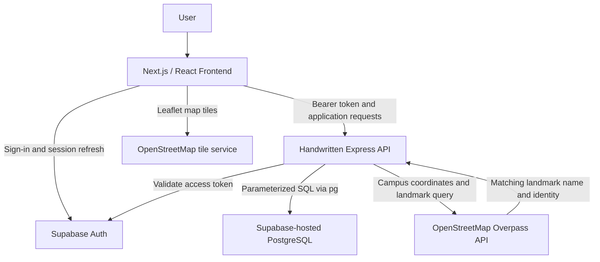
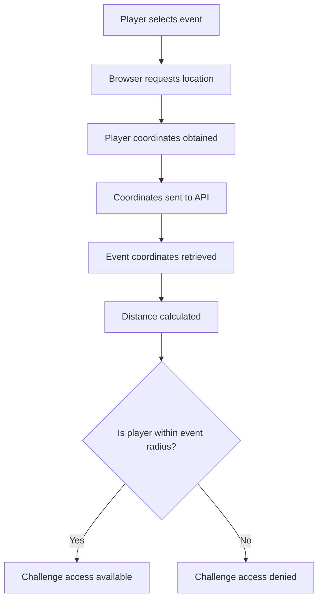
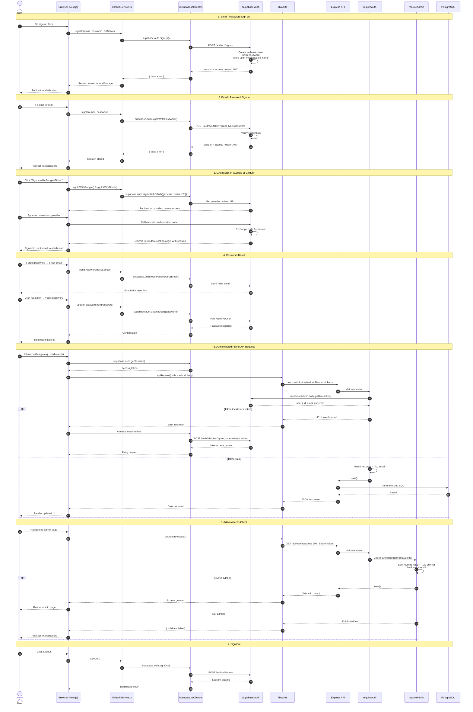
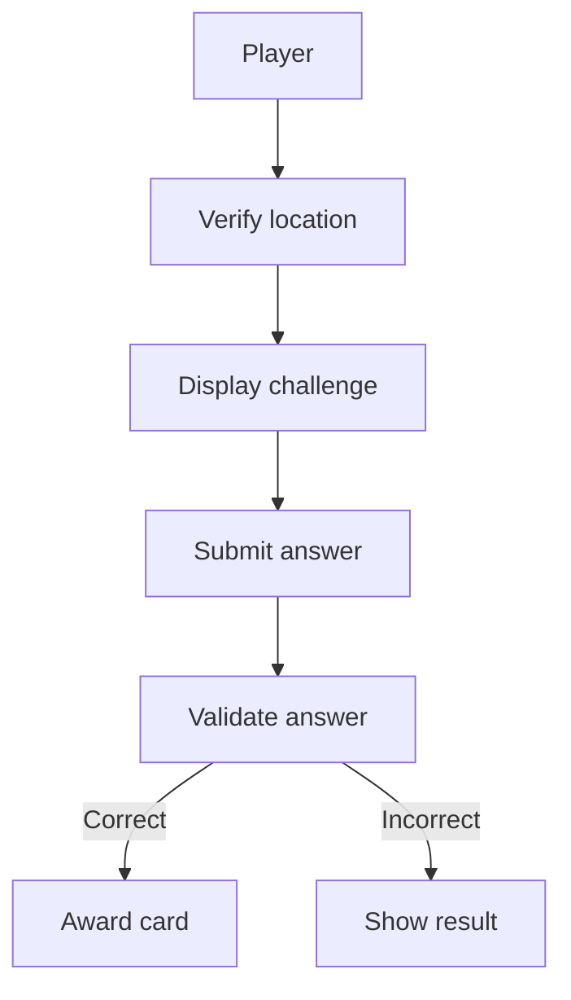
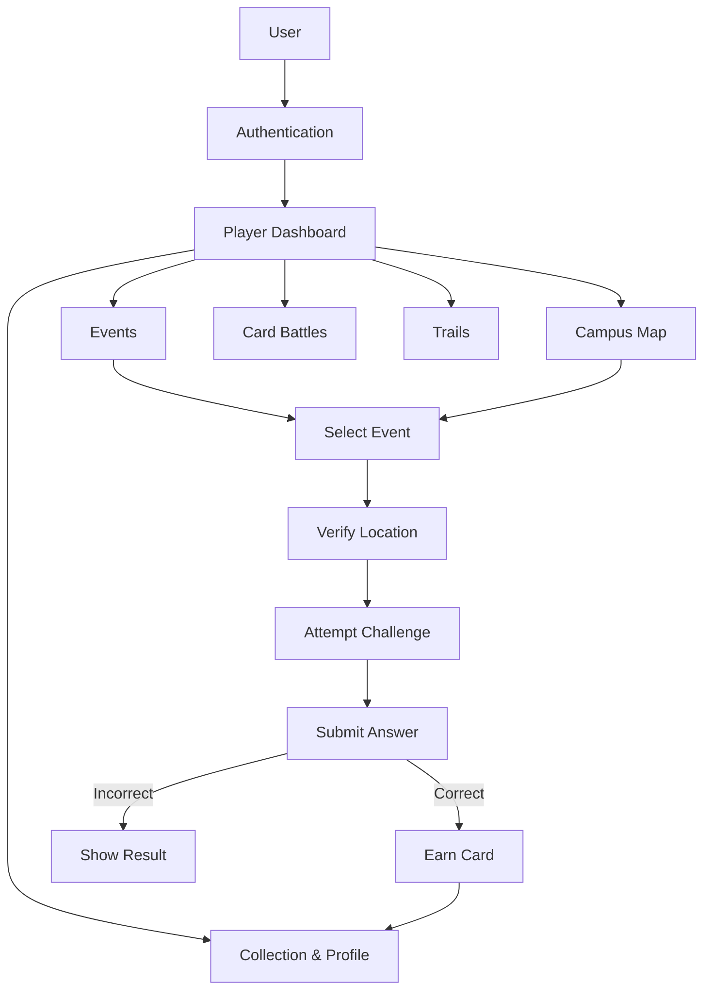

# Wits Quest – System Design

## 1. Introduction

### Ordered trail architecture

The admin trail builder sends ordered event UUIDs to handwritten Express routes in `backend/routes/trails.ts`. `requireAuth` and `requireAdmin` protect authoring; parameterized PostgreSQL queries validate 2–20 distinct existing stops. The `public.trails` table stores draft content, review revisions, and a published snapshot. The trail migration follows the baseline and content-publication migrations, as described in [deployment order](deployment.md#database-installation-and-migration-order). RLS is enabled and direct client table access is revoked; Express uses the existing privileged database connection.

The player Trails page calls `GET /api/trails`. Express expands the published event ID array with ordinality, joins `live_events` and `live_challenges`, and calculates progress from the authenticated player's challenge attempts. The first incomplete stop becomes the next destination. Completing all published questions at a stop counts as completion, even with an incorrect answer; card rewards still follow normal answer rules. Stops without questions are not complete.

Trails provide guidance without enforcing sequential access. Author order takes precedence over distance sorting. Inactive stops remain visible; deleted events become unavailable placeholders. Event IDs are stored as an ordered array without cascading event foreign keys so deletion cannot silently remove or reorder published stops. Draft edits do not affect the player route until reviewed and published. Events themselves retain their independent publication lifecycle. See [the trail API contract](../handwritten-api.md#ordered-trails) for bodies, responses and errors.

**API migration:** Application data now goes through handwritten Express routes and direct PostgreSQL SQL. Supabase is retained for Auth and database hosting only. See the [API contract](../handwritten-api.md), [current database schema](database-schema.md) and [deployment reference](deployment.md).

Wits Quest is a location-based campus game designed for students at the University of the Witwatersrand. Players move around campus, discover active events, verify that they are physically within an event area, and complete challenges to earn collectible cards.

The system also provides an administrative interface where authorised administrators can create events, create challenges, manage cards, and control game content.

The application is implemented using **Next.js, React, TypeScript, Supabase, Tailwind CSS, and Leaflet**.

---

## 2. System Architecture

Wits Quest follows a layered web application architecture consisting of three main layers:

### Presentation Layer

The presentation layer contains the user interface of the application. It is implemented using **Next.js, React, TypeScript, and Tailwind CSS**.

It includes:

- Player dashboard
- Events interface
- Campus map
- Challenge interface
- Admin interface
- Profile and navigation components

### Application Logic Layer

The application logic layer uses handwritten **Express routes and TypeScript services** to handle the main rules and functionality of the game. It validates Supabase Auth access tokens and accesses PostgreSQL through parameterized SQL using `pg`.

This includes:

- Location verification
- Event status checking
- Challenge validation
- Challenge answer submission
- Authentication and access control
- Card awarding
- Campus landmark validation through the external OpenStreetMap Overpass API before event creation or updates

### Data Layer

The data layer uses **Supabase** and its PostgreSQL database.

It is responsible for storing:

- Users
- Events
- Challenges
- Cards
- Location verifications
- Player progress

The overall architecture can be represented as:



### Content drafts and publication

Events and challenges have a saved draft and a separate published JSON snapshot in PostgreSQL. Admin POST/PUT routes edit drafts and increment a revision. Admins preview the server-saved content and explicitly mark that revision reviewed before publishing. The publish operation checks the current draft revision and reviewing admin in its SQL update, so a draft changed after review cannot be published using that stale review.

Player event lists, active-event lists, location verification, question loading and answer grading use the backend-only `live_events` and `live_challenges` views of published snapshots. New drafts are hidden. Draft edits preserve the live version until republished. The admin dashboard reads publication status from Express instead of browser local storage. Authors may review their own work; an independent reviewer is not required. Reward-card edits and content deletion remain immediate admin operations.

The content-publication migration precedes the corresponding backend update. The migration preserves existing live content on first application and does not publish new drafts on reruns. See the [draft/review API contract](../handwritten-api.md#draft-review-and-publication-workflow) for endpoint details.

### External API integration: campus landmark validation

The admin event form sends coordinates to `POST /api/admin/landmarks/lookup` after typing pauses. Express requires an authenticated administrator, validates the numeric coordinates, and calls the Overpass API with a fixed query. It searches within 150 metres for a named building, historic feature, artwork, or museum, restricted to a mapped university or college area containing the coordinates.

The returned landmark name fills an empty event title. Administrators can also select **Use this name as the event title** to replace an existing title, then edit it. The response includes an OpenStreetMap link for attribution and inspection.

Both `POST /api/admin/events` and `PUT /api/admin/events/:id` independently require a successful lookup before writing to PostgreSQL. A caller cannot bypass this by skipping the form lookup. This means external API data directly controls whether an event can be saved, as well as supplying its suggested title. Leaflet's separate tile requests provide the visual map.

The backend caches lookup results for five minutes (up to 200 coordinate entries) and applies a 20-second request timeout. No match returns HTTP 422; an upstream failure returns HTTP 503 and prevents saving. Missing OpenStreetMap campus boundaries or landmark names may cause valid real-world locations to fail validation. Only event coordinates are sent upstream, not user tokens. The selected name can be saved as the event title; no separate landmark database field is added.

The Great Hall test coordinates `-26.1924, 28.0308` returned **Great Hall** during integration testing. Map data can change, so this is a test example rather than a guaranteed future response. Player GPS verification remains a separate process using browser coordinates and the backend's distance calculation.

See the [API reference: landmark lookup](../handwritten-api.md#post-apiadminlandmarkslookup) for request headers, response examples, and errors. Map data is provided by [OpenStreetMap contributors](https://www.openstreetmap.org/copyright).

## 3. Technologies

See the [third-party dependency and attribution register](../third-party-dependencies.md) for library versions, source links, licence metadata, selection rationales, external services, and reused assets.

| Technology | Purpose |
|---|---|
| Next.js | Main web application framework |
| React | Building reusable user interface components |
| TypeScript | Type-safe application development |
| Tailwind CSS | Styling and responsive design |
| Supabase | Authentication and database services |
| Express and pg | Handwritten application endpoints and parameterized SQL |
| OpenStreetMap Overpass API | Campus landmark lookup and validation before saving events |
| PostgreSQL | Persistent data storage |
| Leaflet | Interactive campus map |
| React Leaflet | Integration of Leaflet with React |
| Browser Geolocation API | Obtaining the player's current location |
| GitHub OAuth | User authentication |

---

## 4. Frontend Design

The frontend uses the **Next.js App Router**.

Important application routes include:

Top-level routes:

```text
/Login
/signup
/reset-password
/account/delete
/map
/profile
/settings
```

Authenticated player routes:

```text
/dashboard
/dashboard/events
/dashboard/map
/dashboard/cards
/dashboard/games
/dashboard/games/[gameId]
/dashboard/games/spectate/[gameId]
/dashboard/trails
/dashboard/triviaquestions
/dashboard/leaderboard
/dashboard/notifications
/dashboard/settings
/dashboard/settings/rulebook
```

Administrator routes:

```text
/dashboard/admin
/dashboard/admin/events
/dashboard/admin/challenges
/dashboard/admin/cards
/dashboard/admin/campaigns
/dashboard/admin/trails
/dashboard/admin/stats
/dashboard/admin/moderation
/dashboard/admin/zones
/dashboard/admin/zones/[id]
```

### 4.1 Player Dashboard

The player dashboard acts as the main page after authentication.

It allows players to:

- Navigate through the game
- View events
- Access the campus map
- View notifications
- Access their profile
- Log out

### 4.2 Events Interface

The events interface displays events created for the game.

Each event contains information such as:

- Event title
- Description
- Latitude
- Longitude
- Allowed radius
- Start time
- End time

Players must be within the allowed event radius before they can participate in its challenge.

### 4.3 Campus Map

The campus map is implemented using **Leaflet** and **React Leaflet**.

The map displays the locations of game events using their stored latitude and longitude coordinates.

Events are represented using map markers and their associated location radius.

---

## 5. Location Verification Design

Location verification ensures that players are physically close enough to an event before attempting its challenge.

The browser uses the **Geolocation API** to obtain the player's current:

- Latitude
- Longitude
- Location accuracy

The player's location is sent to the location verification API. The backend retrieves the event's coordinates and compares them with the player's coordinates.

### Location Verification Flow



The system uses the **Haversine formula** to calculate the distance between the player and the event.

The calculated distance is compared with the event's `radius_meters`:

```text
distance <= radius_meters
```

If this condition is true, the player's location is successfully verified.

The system also checks whether the event is currently active based on its start and end times.

---

## 6. Authentication Design

Authentication is handled using **Supabase Auth**, which manages the authenticated user's session.

The application supports three sign-in methods, implemented in `lib/authService.ts`:

| Method | Implementation |
|---|---|
| Email / password | `signUp()` and `signIn()`, using Supabase's built-in `signUp` / `signInWithPassword` |
| Google OAuth | `signInWithGoogle()`, using Supabase's OAuth provider integration |
| GitHub OAuth | `signInWithGithub()`, following the same OAuth pattern |

Protected application functionality checks whether a valid authenticated user exists before allowing access.

### Authentication and authorisation flow

The following sequence diagram shows the full authentication lifecycle: sign-up, sign-in (email/password and OAuth), password reset, token validation on protected API requests, administrator access checks, and sign-out.



**Design notes:**

- **Admin access is environment-driven.** `requireAdmin` checks the `ADMIN_USER_IDS` environment variable (comma-separated `auth.users.id` UUIDs) rather than a database role table. An empty value denies all administrator access.
- **Token validation is authoritative on the backend.** The frontend holds the session, but Express calls `supabaseAdmin.auth.getUser(token)` on every protected request, so a client cannot claim an identity it does not have.
- **The admin access hook defers its re-check.** `useAdminAccess` schedules its refresh via `setTimeout(..., 0)` inside `onAuthStateChange`, avoiding a race with Supabase's internal auth lock during session refresh.
- **CORS is restricted** to the origins listed in the backend's `FRONTEND_URL` environment variable.

---

## 7. Administrator Access

Administrative functionality is separated from normal player functionality.

The main administrative routes are:

```text
/dashboard/admin/events
/dashboard/admin/challenges
/dashboard/admin/cards
/dashboard/admin/campaigns
/dashboard/admin/trails
/dashboard/admin/stats
/dashboard/admin/moderation
/dashboard/admin/zones
```

Admin pages perform an additional authorisation check. If a user does not have administrator access, they are redirected to the normal dashboard. Moderator pages use the same authorisation path.

Administrators can manage:

- Events
- Challenges
- Cards
- Campaigns and schedule windows
- Trails and ordered routes
- Analytics on question difficulty and engagement

Moderators can additionally:

- Review flagged players through the moderation console
- Apply proportionate actions (warning, throttle, restrict, ban)

---

## 8. Event Management

Administrators can create, view, update, and delete events.

An event contains:

```text
Event
-------------------------
id
title
description
latitude
longitude
radius_meters
starts_at
ends_at
created_at
```

The administrator provides the event's coordinates and radius. These values are later used during player location verification.

---

## 9. Challenge Management

Each event can have one or more challenges.

Administrators manage challenges through:

```text
/dashboard/admin/challenges
```

A challenge contains information such as:

```text
Challenge
-------------------------
id
event_id
question_text
question_type
options
correct_answer
card_id
created_at
```

The `event_id` associates a challenge with an event.

The application supports three challenge question types:

- Multiple choice
- True / False
- Text answer

### Multiple Choice

Multiple-choice challenges contain a list of possible answers. The administrator must provide at least two options and specify the correct answer, which must match one of the provided options.

### True / False

True/False challenges allow the administrator to select either `True` or `False` as the correct answer.

### Text Answer

Text challenges allow players to manually enter an answer, which is compared with the expected answer stored for the challenge.

---

## 10. Challenge Submission

After a player's location has been successfully verified, the player can attempt the challenge associated with the event.

The general challenge flow is:


The player's submitted answer is compared with the challenge's stored correct answer. If the answer is correct, the player receives the associated card.

---

## 11. Card System

Cards are rewards that players can earn by successfully completing challenges.

Administrators can manage cards from:

```text
/dashboard/admin/cards
```

A card can contain information such as:

- Title
- Description
- Rarity
- Theme
- Associated challenge or event

Cards provide a reward and progression mechanism for players participating in Wits Quest.

---

## 12. Database Design

The current checked-in schema defines 23 application tables and two published-content views in Supabase-hosted PostgreSQL. Supabase manages the separate Auth identity tables.

The [full database reference](database-schema.md) lists every application column, type, default, constraint and relationship, including trails, notifications, deck snapshots, duel stakes, profile images, album covers, campaigns, offline attempt sessions, zones, zone claims, card trades, trust scores, trust events, moderation flags and player ratings. It includes the ER diagram, indexes, deletion behaviour and reasons for the design choices.

Application data is accessed through authenticated Express routes and parameterized SQL. The backend verifies administrator UUIDs and player ownership; direct browser table access is restricted by the SQL access-control migrations. Draft content and live snapshots are separate, and critical ownership operations use transactions.

[Deployment and database setup](deployment.md) documents the hosting layout, environment configuration, migration order and compatibility considerations for existing databases.

---

## 13. Component Design

The frontend uses reusable React components to reduce duplicated code.

Examples include:

```text
Sidebar
ProfileMenu
ProfileMenuContainer
LogoutButton
CampusMap
```

### Sidebar

The sidebar provides navigation between the main application pages, including links such as Dashboard, Events, and Notifications. The sidebar can also be collapsed to provide more screen space.

### Profile Menu

The profile menu displays information about the authenticated user and provides account-related functionality.

### Campus Map

The `CampusMap` component displays game events geographically using React Leaflet. It retrieves event information and displays event markers on the campus map.

### Backend route and service structure

The backend exposes 8 route files and 18 service modules:

```text
backend/routes/
├── admin.ts
├── catalog.ts
├── games.ts
├── trails.ts
├── trades.ts
├── zones.ts
└── events/
    ├── submitAnswer.ts
    └── verifyLocation.ts

backend/services/
├── accountService.ts
├── authClient.ts
├── battleService.ts
├── challengeService.ts
├── database.ts
├── eventPlacementService.ts
├── exchangeService.ts
├── gameService.ts
├── imageValidation.ts
├── landmarkService.ts
├── locationService.ts
├── moderationService.ts
├── notifications.ts
├── proceduralEventService.ts
├── progressService.ts
├── ratingService.ts
├── stakeService.ts
└── validation.ts
```

The frontend service layer in `frontend/lib/` contains 17 modules:

```text
frontend/lib/
├── adminChallenges.ts
├── api.ts
├── authService.ts
├── battle.ts
├── distance.ts
├── eventsService.ts
├── geo.ts
├── offlineDb.ts
├── offlineSync.ts
├── photo.ts
├── supabaseClient.ts
├── trails.ts
├── trivia.ts
├── useAdminAccess.ts
├── useChallenge.ts
├── useLocationVerification.ts
└── useOfflineSync.ts
```

## Component diagram

The following diagram shows the frontend and backend components, and how they depend on each other. It complements the deployment view (which services run where) and the database schema (which tables exist) by showing the **module structure** of the codebase.

```mermaid
graph TB
    subgraph FE["Frontend — Next.js App Router"]
        subgraph PAGES_TOP["Top-level pages"]
            P_LOGIN["/Login"]
            P_SIGNUP["/signup"]
            P_RESET["/reset-password"]
            P_DELACC["/account/delete"]
            P_TOPMAP["/map"]
            P_PROFILE["/profile"]
            P_TOPSET["/settings"]
        end

        subgraph PAGES_PLAYER["Player dashboard"]
            P_DASH["/dashboard"]
            P_EVENTS["/dashboard/events"]
            P_MAP["/dashboard/map"]
            P_CARDS["/dashboard/cards"]
            P_GAMES["/dashboard/games"]
            P_GAME["/dashboard/games/[gameId]"]
            P_SPEC["/dashboard/games/spectate/[gameId]"]
            P_TRAILS["/dashboard/trails"]
            P_TRIVIA["/dashboard/triviaquestions"]
            P_LB["/dashboard/leaderboard"]
            P_NOTIF["/dashboard/notifications"]
            P_SETTINGS["/dashboard/settings"]
            P_RULEBOOK["/dashboard/settings/rulebook"]
        end

        subgraph PAGES_ADMIN["Admin pages"]
            A_HOME["/dashboard/admin"]
            A_EVENTS["admin/events"]
            A_CHAL["admin/challenges"]
            A_CARDS["admin/cards"]
            A_CAMP["admin/campaigns"]
            A_TRAILS["admin/trails"]
            A_STATS["admin/stats"]
            A_MOD["admin/moderation"]
            A_ZONES["admin/zones"]
            A_ZONE["admin/zones/[id]"]
        end

        subgraph LAYOUT["Layout & navigation"]
            L_DASH["dashboard/layout.tsx"]
            C_SIDEBAR["Sidebar"]
            C_ASIDEBAR["AdminSidebar"]
            C_PMENU["ProfileMenu / Container"]
            C_LOGOUT["LogoutButton"]
        end

        subgraph COMP_PLAYER["Player components"]
            C_MAP["CampusMap"]
            C_EVLOC["EventLocationCheck"]
            C_QR["EventQrCode"]
            C_CHAL["ChallengeCard"]
            C_QUESTP["QuestProgress"]
            C_QUESTS["QuestStages"]
            C_TRIVIA["TriviaDeck"]
            C_REWARD["RewardReveal"]
            C_WITS["WitsScreen"]
            C_TRUST["TrustAndRatingBadge"]
        end

        subgraph COMP_BATTLE["Battle & cards"]
            C_BCARD["BattleCard"]
            C_BREVEAL["BattleReveal"]
            C_DUP["DuplicateExchange"]
            C_LEGACY["LegacyGameRoom"]
            C_COLL["CollectibleCard"]
            C_EMB["CardEmblem"]
            C_INSP["CardInspector"]
            C_ART["CampusArtwork"]
        end

        subgraph COMP_ADMIN["Admin components"]
            C_CREV["ContentReview"]
            C_PHOTO["PhotoEditor"]
            C_ALBUM["AlbumCoverEditor"]
            C_FWD["ForwardArrowIcon"]
        end

        subgraph COMP_OFFLINE["Offline support"]
            C_OFF["OfflineSyncProvider"]
        end

        subgraph AUTH["Auth components"]
            F_SIGNIN["SignInForm"]
            F_SIGNUP["SignUpForm"]
        end

        subgraph LIB["lib services"]
            L_API["api.ts"]
            L_AUTH["authService.ts"]
            L_SUPA["supabaseClient.ts"]
            L_ADMIN["useAdminAccess.ts"]
            L_OFFSYNC["offlineSync.ts"]
            L_OFFDB["offlineDb.ts"]
            L_USEOFF["useOfflineSync.ts"]
            L_LOCVER["useLocationVerification.ts"]
            L_CHAL["useChallenge.ts"]
            L_EVENT["eventsService.ts"]
            L_GEO["geo.ts"]
            L_DIST["distance.ts"]
            L_TRAIL["trails.ts"]
            L_TRIVIA["trivia.ts"]
            L_BATTLE["battle.ts"]
            L_PHOTO["photo.ts"]
            L_ADMCHAL["adminChallenges.ts"]
        end
    end

    subgraph BE["Backend — Express"]
        subgraph ROUTES["Routes (8)"]
            R_ADMIN["routes/admin.ts"]
            R_CATALOG["routes/catalog.ts"]
            R_GAMES["routes/games.ts"]
            R_TRAILS["routes/trails.ts"]
            R_TRADES["routes/trades.ts"]
            R_ZONES["routes/zones.ts"]
            R_VERIFY["events/verifyLocation.ts"]
            R_ANSWER["events/submitAnswer.ts"]
        end
        subgraph MW["Middleware"]
            M_AUTH["requireAuth.ts"]
            M_ADMIN["requireAdmin.ts"]
        end
        subgraph SVC["Services (18)"]
            S_DB["database.ts"]
            S_AUTHCLIENT["authClient.ts"]
            S_LOC["locationService.ts"]
            S_LAND["landmarkService.ts"]
            S_CHAL["challengeService.ts"]
            S_GAME["gameService.ts"]
            S_BATTLE["battleService.ts"]
            S_EXCH["exchangeService.ts"]
            S_STAKE["stakeService.ts"]
            S_NOTIF["notifications.ts"]
            S_VAL["validation.ts"]
            S_IMG["imageValidation.ts"]
            S_ACCT["accountService.ts"]
            S_MOD["moderationService.ts"]
            S_RATE["ratingService.ts"]
            S_PROG["progressService.ts"]
            S_PLACE["eventPlacementService.ts"]
            S_PROC["proceduralEventService.ts"]
        end
    end

    subgraph DATA["Supabase PostgreSQL"]
        DB["23 tables + 2 views"]
        V_LIVE["live_events / live_challenges"]
    end

    subgraph EXT["External APIs"]
        OSMP["OpenStreetMap Overpass API"]
        TILES["OpenStreetMap Tiles"]
        AUTH_SUP["Supabase Auth"]
    end

    L_DASH --> C_SIDEBAR
    L_DASH --> C_PMENU
    C_PMENU --> C_LOGOUT
    C_ASIDEBAR --> A_HOME

    P_DASH --> C_SIDEBAR
    P_EVENTS --> C_MAP
    P_EVENTS --> C_EVLOC
    P_EVENTS --> C_CHAL
    P_MAP --> C_MAP
    P_GAMES --> C_BCARD
    P_GAMES --> C_DUP
    P_GAME --> C_BREVEAL
    P_GAME --> C_LEGACY
    P_CARDS --> C_COLL
    P_TRAILS --> C_QUESTP
    P_TRAILS --> C_QUESTS
    P_TRIVIA --> C_TRIVIA
    P_DASH --> C_WITS
    P_DASH --> C_TRUST
    P_LB --> C_TRUST
    C_EVLOC --> C_QR
    C_CHAL --> C_REWARD

    A_EVENTS --> C_CREV
    A_EVENTS --> C_QR
    A_CHAL --> C_CREV
    A_CARDS --> C_CREV
    A_TRAILS --> C_CREV
    A_HOME --> C_ASIDEBAR

    C_COLL --> C_EMB
    C_COLL --> C_INSP
    C_ART --> C_COLL

    C_PHOTO --> L_PHOTO
    C_ALBUM --> L_PHOTO

    C_OFF --> L_USEOFF
    L_USEOFF --> L_OFFSYNC
    L_OFFSYNC --> L_OFFDB

    F_SIGNIN --> L_AUTH
    F_SIGNUP --> L_AUTH
    L_AUTH --> L_SUPA
    L_ADMIN --> L_SUPA

    P_EVENTS --> L_EVENT
    P_MAP --> L_GEO
    P_MAP --> L_DIST
    P_TRAILS --> L_TRAIL
    P_TRIVIA --> L_TRIVIA
    P_GAMES --> L_BATTLE
    A_CHAL --> L_ADMCHAL

    L_LOCVER --> L_API
    L_CHAL --> L_API
    L_ADMIN --> L_API
    L_USEOFF --> L_API

    C_MAP --> L_API
    C_EVLOC --> L_LOCVER
    C_CHAL --> L_CHAL
    C_DUP --> L_API
    C_CREV --> L_API
    C_QR --> L_API
    C_BCARD --> L_API
    C_BREVEAL --> L_API

    L_API --> R_ADMIN
    L_API --> R_CATALOG
    L_API --> R_GAMES
    L_API --> R_TRAILS
    L_API --> R_TRADES
    L_API --> R_ZONES
    L_API --> R_VERIFY
    L_API --> R_ANSWER
    L_SUPA --> AUTH_SUP

    R_ADMIN --> M_AUTH
    R_ADMIN --> M_ADMIN
    R_CATALOG --> M_AUTH
    R_GAMES --> M_AUTH
    R_TRAILS --> M_AUTH
    R_TRADES --> M_AUTH
    R_ZONES --> M_AUTH
    R_VERIFY --> M_AUTH
    R_ANSWER --> M_AUTH

    M_AUTH --> S_AUTHCLIENT

    R_ADMIN --> S_DB
    R_ADMIN --> S_VAL
    R_ADMIN --> S_IMG
    R_ADMIN --> S_LAND
    R_ADMIN --> S_MOD
    R_ADMIN --> S_PLACE
    R_ADMIN --> S_PROC
    R_CATALOG --> S_DB
    R_GAMES --> S_GAME
    R_GAMES --> S_BATTLE
    R_GAMES --> S_STAKE
    R_GAMES --> S_RATE
    R_TRAILS --> S_DB
    R_TRADES --> S_DB
    R_ZONES --> S_DB
    R_VERIFY --> S_LOC
    R_VERIFY --> S_DB
    R_ANSWER --> S_CHAL
    R_ANSWER --> S_DB
    R_ANSWER --> S_PROG

    S_CHAL --> S_DB
    S_GAME --> S_BATTLE
    S_BATTLE --> S_DB
    S_EXCH --> S_DB
    S_STAKE --> S_DB
    S_NOTIF --> S_DB
    S_ACCT --> S_DB
    S_LOC --> S_DB
    S_LAND --> OSMP
    S_MOD --> S_DB
    S_RATE --> S_DB
    S_PROG --> S_DB
    S_PLACE --> S_DB
    S_PROC --> S_DB
    S_PROC --> S_PLACE

    S_DB --> DB
    S_DB --> V_LIVE

    C_MAP --> TILES
```



**Notes:**

- **Layered by concern.** Frontend split into pages, components, and `lib/` services; backend split into routes, middleware, and services.
- **Player and admin flows share `lib/api.ts`** and both go through `requireAuth` on the backend.
- **Offline support is isolated in its own module** (`OfflineSyncProvider` → `useOfflineSync` → `offlineSync` → `offlineDb`). It replays queued attempts through the same `api.ts` path when reconnected.
- **Landmark lookup is admin-only.** The Overpass API is called by `landmarkService.ts` during event save (POST/PUT), not from the browser.
- **`live_events` and `live_challenges`** are the read-only views for player-facing queries; admin routes read draft columns directly.
- **All database access flows through `services/database.ts`**, which owns the `pg` connection pool.

---

## 14. Service and Utility Design

Reusable application logic is separated from UI components where appropriate.

Utility and service functions handle functionality such as:

- Supabase configuration
- Event retrieval
- Geographic calculations
- Location verification
- Event status calculation
- Authentication

This reduces duplicated code and keeps components focused on presentation.

---

## 15. Security Design

### Authentication

Users must authenticate before accessing protected functionality.

### Administrator Authorisation

Admin functionality performs additional checks to prevent normal players from accessing administrative pages.

### Location Validation

The player's reported location is compared with the stored event location before the challenge is made available. The application can reject location readings when the reported GPS accuracy is too poor.

### Offline replay protection

Offline attempts are only accepted when the player holds a valid server-issued lease. The lease expires, has a sync deadline, and can only be consumed once, preventing unbounded replay.

### Anti-cheat enforcement

Each player has a trust score derived from movement plausibility, submission patterns and match behaviour. Low trust triggers proportionate responses: increased verification strictness, throttling, or moderator review. Automatic bans are not applied.

### Server-Side Validation

Important game rules are validated by backend/API logic rather than relying only on frontend validation. This reduces the possibility of users bypassing game restrictions by modifying frontend behaviour.

---

## 16. Error Handling

The system provides feedback when operations fail.

Possible errors include:

- User is not authenticated
- User does not have administrator access
- Location permission is denied
- Player location cannot be determined
- GPS accuracy is insufficient
- Player is outside the event radius
- Event is inactive
- Challenge information is invalid
- Database operation fails
- Implausible movement detected
- Offline attempt lease expired or already consumed
- Trade cannot be completed (card no longer owned)
- Rating or matchmaking lookup fails

The application also displays confirmation messages when administrative operations are successful, for example:

```text
Challenge added successfully.
Challenge updated successfully.
Challenge deleted successfully.
```

---

## 17. Overall System Flow


---

## 18. Design Summary

Wits Quest uses a modular web application design that separates the **user interface, application logic, authentication, and database functionality**.

Next.js and React provide the frontend interface, while Supabase provides authentication and persistent database storage. Leaflet provides the interactive campus map, and the browser's Geolocation API provides player location information.

The core game flow consists of:

1. A player authenticating into the application.
2. The player discovering an event.
3. The application verifying the player's location.
4. The player attempting the event's challenge.
5. The application validating the submitted answer.
6. The player receiving a card after successfully completing the challenge.

Advanced features extend this core loop with real-time and asynchronous PvP, competitive ratings, zone control, trading, procedural event placement, and a trust and moderation system that responds proportionately to suspected cheating.

This structure allows Wits Quest to combine location-based gameplay, campus exploration, challenges, collectible rewards, competitive play and anti-cheat enforcement in a single web application.