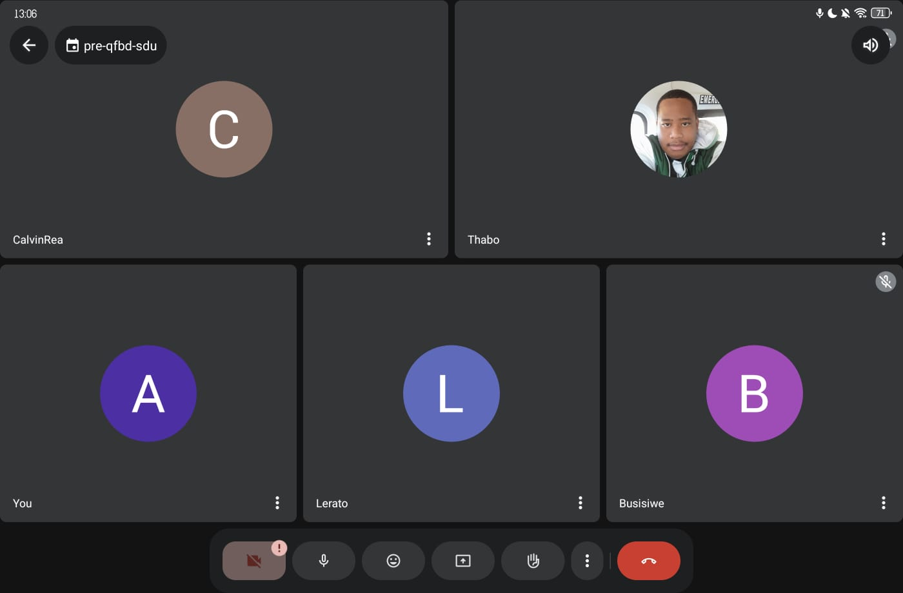

## Meeting 1 — Final Client Feedback

**Date:** 9 October 2026

**Attendees:** 

* Busisiwe Dlamini
* Lerato Sikhumbana
* Anovuyo Dlamini
* Thabo Maleke

### Purpose

We met with our client to get final feedback on the app after implementing the advanced features from Sprint 3.

### Discussion

#### 1. Advanced Features

The client asked about the advanced features. We explained that all of them had been implemented, but one or two still had issues that we were working on fixing.

#### 2. User Feedback

We explained that we had collected user feedback and made changes to the app based on the suggestions we received.

#### 3. Documentation

The client asked whether we had documented everything. We confirmed that we had completed the project documentation.

#### 4. API Deployment

The client asked whether our APIs were deployed and available for use. We confirmed that they had been deployed and were accessible.

### Client Feedback and Outcome

The client advised us to finish fixing the remaining issues. He said that once these issues were resolved, our work would be complete.

### Action Items

- Fix the remaining issues in the advanced features.
- Test the affected features again to confirm that the fixes work.

